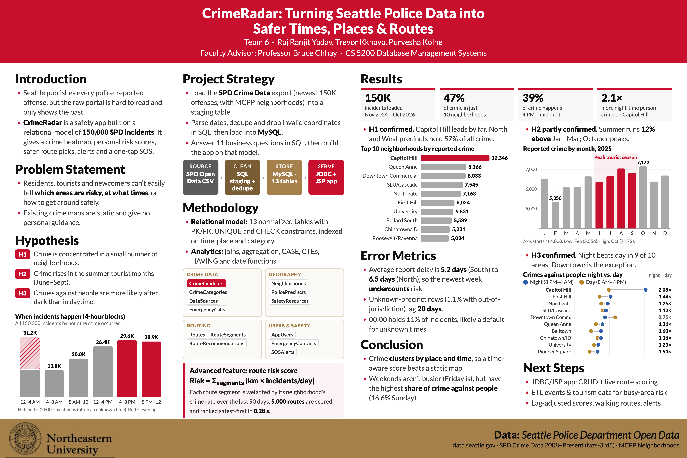

# CrimeRadar

**Turning Seattle Police data into safer times, places and routes.**

CrimeRadar is a Seattle crime-safety app built on a MySQL relational model of
150,000 Seattle Police Department (SPD) offense records. It is designed to give
residents, tourists and newcomers a crime heatmap, personal risk scores, safer
route recommendations, alerts and a one-tap SOS button.

Team project for **CS 5200 Database Management Systems** at Northeastern University.



## Repository layout

| Path | What it is |
|---|---|
| [`sql/crime_radar_all.sql`](sql/crime_radar_all.sql) | Builds the `CrimeRadar` database: drops and creates all tables, loads and cleans the SPD CSV, generates sample rows for the supporting tables, and prints row counts |
| [`sql/milestone3_business_queries.sql`](sql/milestone3_business_queries.sql) | The 11 business-insight queries (Milestone 3) |
| [`docs/CrimeRadar-Milestone3.pdf`](docs/CrimeRadar-Milestone3.pdf) | Milestone 3 report with query results |
| [`poster/`](poster) | Showcase poster: HTML source, print PDF (36 × 24 in) and PNG |
| [`data/`](data) | Where the SPD CSV goes (not committed). See [`data/README.md`](data/README.md) |

## Data model

The schema covers four areas, with `CrimeIncidents` at the center:

- **Crime data:** `CrimeIncidents`, `CrimeCategories`, `DataSources`, `EmergencyCalls`
- **Geography:** `Neighborhoods`, `PolicePrecincts`, `SafetyResources`
- **Routing:** `Routes`, `RouteSegments`, `RouteRecommendations`, `RiskScores`
- **Users and safety:** `AppUsers`, `EmergencyContacts`, `SOSAlerts`

Tables use primary and foreign keys, `UNIQUE` and `CHECK` constraints, and
indexes on time, neighborhood and category.

**Data:** `CrimeIncidents` and its lookup tables come from real SPD data
([SPD Crime Data: 2008–Present](https://data.seattle.gov/Public-Safety/SPD-Crime-Data-2008-Present/tazs-3rd5)),
covering November 2024 to October 2026. The other tables hold generated
sample rows so the app features can be built and tested.

## Running it

Requires MySQL 8.0+.

```bash
# 1. Put the SPD CSV in data/ (see data/README.md), then from the repo root:
mysql --local-infile=1 -u root -p < sql/crime_radar_all.sql

# 2. Run the business queries
mysql -u root -p < sql/milestone3_business_queries.sql
```

## Key findings

| Question | Finding |
|---|---|
| Where is crime concentrated? | 10 neighborhoods hold **47%** of all incidents. Capitol Hill leads with 12,346. |
| Which precincts? | North (30%) and West (27%) together hold 57% of crime. |
| When during the day? | **39%** of incidents happen between 4 PM and midnight. |
| Is summer worse? | Summer 2025 (Jun–Sep) ran 12% above Jan–Mar, but October was the peak month. |
| Is night riskier for people? | Yes in 9 of the top 10 neighborhoods. Capitol Hill has **2.1×** more person crime at night than by day. Downtown is the exception. |
| Are weekends riskier? | Not by volume (Friday is busiest), but weekends have the highest share of crime against people (16.6% on Sunday). |
| How fresh is the data? | Crimes are reported 5.2–6.5 days after they happen on average, so the newest week undercounts risk. |

## Advanced feature: route risk score

Each route is split into segments, and each segment is weighted by its
neighborhood's crime rate over the last 90 days:

```
Risk = Σ over segments (segment km × neighborhood incidents per day)
```

The query scores and ranks 5,000 routes safest-first in about 0.28 s
(Q11 in [`milestone3_business_queries.sql`](sql/milestone3_business_queries.sql)).

## Roadmap

- Java JDBC + JSP web app with full CRUD and live route scoring
- ETL workflows that add events and tourism data to predict busy-area risk
- Lag-adjusted risk scores, walking routes and multilingual alerts

## Team

Team 6: Raj Ranjit Yadav, Trevor Kkhaya, Purvesha Kolhe
Faculty advisor: Professor Bruce Chhay
